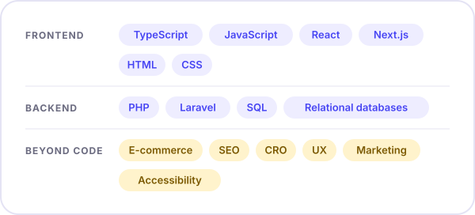
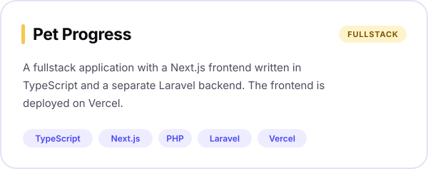
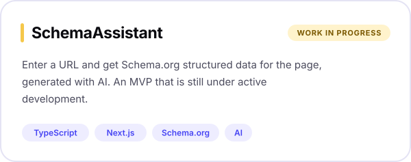
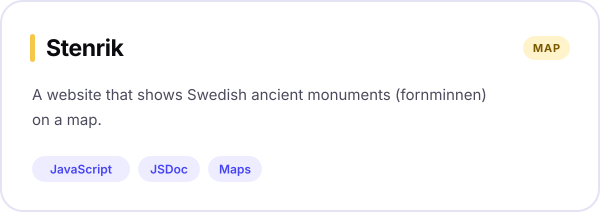

  

&nbsp;&nbsp;&nbsp;&nbsp;

  

## About

I’m a fullstack developer based in Gothenburg. I come from e-commerce, where I worked with SEO, conversion optimisation, UX and marketing. These days I mostly write TypeScript, React and Next.js on the front end, PHP and Laravel on the back end, and SQL underneath.

That background shapes how I work. I want to know what a feature is for and who it helps before I build it, and I care about the things that tend to get skipped: search visibility, usability and accessibility.

- **Right now:** building [SchemaAssistant](https://github.com/davidallert/schemassistant_client), a tool that generates Schema.org structured data from a URL
- **Looking for:** fullstack or frontend roles with React, Next.js or Laravel <!-- edit this line to match what you want -->
- **Based in:** Gothenburg, Sweden

  

## Choose your path

Pick whichever fits you best and I’ll keep it short.

<b>I’m a recruiter or hiring manager</b>

 

- **Role:** fullstack developer
- **Stack:** TypeScript, JavaScript, React, Next.js, PHP, Laravel, SQL
- **Background:** e-commerce, so I know SEO, CRO, UX and marketing from the business side
- **Where to start:** [Petfolio](https://github.com/davidallert/pet_progress_frontend) has a live demo, and I created [SchemaAssistant](https://github.com/davidallert/schemassistant_client) as part of my [university thesis](https://www.diva-portal.org/smash/record.jsf?faces-redirect=true&aq2=%5B%5B%5D%5D&af=%5B%5D&searchType=SIMPLE&sortOrder2=title_sort_asc&query=&language=sv&pid=diva2%3A1987132&aq=%5B%5B%5D%5D&sf=all&aqe=%5B%5D&sortOrder=author_sort_asc&onlyFullText=false&noOfRows=50&dswid=627)
- **Location:** Gothenburg, Sweden
- **Contact:** [LinkedIn](https://www.linkedin.com/in/david-allert/)

 

<b>I’m a developer</b>

 

- My projects are split into separate frontend and backend repositories, the way they usually are on a team.
- The frontends are written in TypeScript on Next.js.
- The Laravel backend has PHPUnit set up.
- Stenrik is plain JavaScript documented with JSDoc.
- I try to get the basics right: semantic HTML, accessibility and sensible data modelling.

 

<b>I work in e-commerce or marketing</b>

 

I’ve worked on the marketing and conversion side of online stores, so SEO, CRO and UX are familiar ground, and I’m comfortable in a room with both marketers and developers.

[SchemaAssistant](https://github.com/davidallert/schemassistant_client) sits right on that line. It generates Schema.org structured data for a page from its URL, which helps search engines understand what the page is about.

 

  

## Stack

<picture>
  <source media="(prefers-color-scheme: dark)" srcset="assets/stack-dark.svg">
  
</picture>

  

## Projects

<picture>
  <source media="(prefers-color-scheme: dark)" srcset="assets/card-pet-progress-dark.svg">
  
</picture>
 
<a href="https://petfolio.se">Live demo</a>&nbsp;&nbsp;·&nbsp;&nbsp;<a href="https://github.com/davidallert/pet_progress_frontend">Frontend</a>&nbsp;&nbsp;·&nbsp;&nbsp;<a href="https://github.com/davidallert/pet_progress_backend">Backend</a>

 

<picture>
  <source media="(prefers-color-scheme: dark)" srcset="assets/card-schemassistant-dark.svg">
  
</picture>
 
<a href="https://github.com/davidallert/schemassistant_client">Client</a>&nbsp;&nbsp;·&nbsp;&nbsp;<a href="https://github.com/davidallert/schemassistant_server">Server</a>

&nbsp;&nbsp;

 

<picture>
  <source media="(prefers-color-scheme: dark)" srcset="assets/card-stenrik-dark.svg">
  
</picture>
 
<a href="https://github.com/davidallert/stenrik">Repository</a>

  

## Contribution graph

My contribution graph, played by a snake. It’s generated by a GitHub Action in this repository and refreshes automatically.

<picture>
  <source media="(prefers-color-scheme: dark)" srcset="https://raw.githubusercontent.com/davidallert/davidallert/output/github-snake-dark.svg" />
  <source media="(prefers-color-scheme: light)" srcset="https://raw.githubusercontent.com/davidallert/davidallert/output/github-snake.svg" />
  
</picture>

 

<b>More arcade games</b>

 

The same graph, played by five more games.

**Pac-Man**

<picture>
  <source media="(prefers-color-scheme: dark)" srcset="https://raw.githubusercontent.com/davidallert/davidallert/arcade/pacman-contribution-graph-dark.svg" />
  
</picture>

 

**Breakout**

<picture>
  <source media="(prefers-color-scheme: dark)" srcset="https://raw.githubusercontent.com/davidallert/davidallert/arcade/breakout-contribution-graph-dark.svg" />
  
</picture>

 

**Galaga**

<picture>
  <source media="(prefers-color-scheme: dark)" srcset="https://raw.githubusercontent.com/davidallert/davidallert/arcade/galaga-contribution-graph-dark.svg" />
  
</picture>

 

**Puzzle Bobble**

<picture>
  <source media="(prefers-color-scheme: dark)" srcset="https://raw.githubusercontent.com/davidallert/davidallert/arcade/puzzle-bobble-contribution-graph-dark.svg" />
  
</picture>

 

**Bomberman**

<picture>
  <source media="(prefers-color-scheme: dark)" srcset="https://raw.githubusercontent.com/davidallert/davidallert/arcade/bomberman-contribution-graph-dark.svg" />
  
</picture>

 

**Minesweeper**

<picture>
  <source media="(prefers-color-scheme: dark)" srcset="https://raw.githubusercontent.com/davidallert/davidallert/arcade/minesweeper-contribution-graph-dark.svg" />
  
</picture>

 

  

## Get in touch

If you’re hiring, or just want to talk, LinkedIn is the best way to reach me.

 

  

